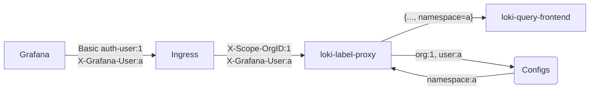

loki-label-proxy
================

`loki-label-proxy` can enforce given labels in a LogQL query coming from Grafana based on `X-Grafana-User` header. It is meant to be used in multi-tenant Grafana/Loki setup.

### How it works:

- Each Grafana Org have separate Loki datasource configured with a separate Basic Auth users. At query time Grafana sets 2 headers: `X-Grafana-Org-Id` and `X-Grafana-User`. 
- We cannot trust `X-Grafana-Org-Id` as it can be overridden by Grafana Org admin on datasource configuration page. So, to map Grafana Org to Loki tenant we use `X-Scope-OrgID` header which is set by Ingress based on auth-user.
- If `X-Scope-OrgID` header value is not found in configs, request is denied (400).
- We can trust `X-Grafana-User` as Org admin already has the widest permissions to its tenant logs
- Based on this header `loki-label-proxy` then rewrites the query to enforce given labels for this user from configuration file. 

### Configuration file:
```yaml
org: '1'    # X-Scope-OrgID header value
users:
  default:  # applied to unknown users and merged into known users
    app: app-prod-.* # {...+, app=~"app-prod-.*"}

  user1@corp.domain:
    namespace: namespace1  # user1 queries must match app-prod-.* AND namespace1

  user2@corp.domain:
    app: app-stage-.* # same-label overrides are combined as app-prod-.*|app-stage-.*

  admin: {}            # empty = admin access, no additional labels are enforced
```
You can specify folder to read configuration files from. Each file should have users for single Org. Org id is unique and not merged, so last file read wins. Specified config path is monitored for changes and configs are reloaded automatically.

The `default` section is applied to unknown users. For known users with non-empty label sections, `default` labels and user labels are merged into one enforced matcher set. Different labels are combined with AND semantics: `default: {app: app-prod-.*}` plus `user1: {namespace: namespace1}` rewrites selectors to include both `app=~"app-prod-.*"` and `namespace=~"namespace1"`. If a known user sets the same label as `default` with a different value, the two values are combined into one regexp OR value, for example `app=~"app-prod-.*|app-stage-.*"`.

An explicitly empty user section, for example `admin: {}`, is treated as unrestricted admin access and no additional labels are enforced. If `default` section is not set, config loading fails.

### Installation:
arm64/amd64 compiled images are available on docker hub: 
```sh
$ docker run sepa/loki-label-proxy
usage: loki-label-proxy [<flags>]

Proxy to enforce LogQL stream labels

Flags:
  -h, --help                 Show context-sensitive help (also try --help-long and --help-man).
      --version              Show application version.
      --addr="http://localhost:3100"
                             Server address. Can also be set using LOKI_ADDR env var.
      --loki-user=""         Username for connection to Loki. Can also be set using LOKI_USERNAME env var.
      --loki-pass=""         Password for connection to Loki. Can also be set using LOKI_PASSWORD env var.
      --auth-user=""         Username for HTTP basic auth. (Enables auth to proxy itself)
      --auth-pass-sha256=""  sha256 of password for HTTP basic auth.
      --config=/configs ...  Path to config files/dirs (repeated).
      --log=info             Log filtering level (info, debug)
```
