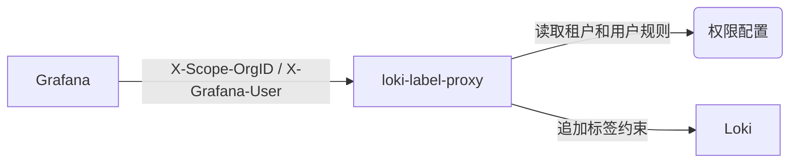

# loki-label-proxy

根据 Grafana 传入的 `X-Scope-OrgID` 和 `X-Grafana-User`，为 LogQL 查询强制追加用户的标签权限，让不同用户查看各自获准的游戏日志。日志查询和标签名称、标签值查询均受权限约束。



## 安装与启动

以下服务安装步骤适用于使用 systemd 的 Linux。在项目根目录执行编译和 Makefile 命令。

### 1. 编译

需要 Go 1.24 或更新版本；服务安装还需要 GNU make、Bash 和 systemd。

```sh
# 直接编译，不运行测试。
CGO_ENABLED=0 go build -o loki-label-proxy .
```

如果需要 Makefile 注入版本和构建信息，可执行 `make build`；该目标会先运行 `go vet ./...` 和 `go test ./...`。

### 2. 安装

```sh
# 使用上一步已编译的二进制，跳过 build 及其测试依赖。
sudo make -o build install
```

直接执行 `make install` 会先执行 `build`，包括上述检查和测试。安装需要管理员权限，但不会自动启动服务。

默认安装内容：

```text
/usr/local/loki-label-proxy/
├── loki-label-proxy             # 程序
├── start.sh                     # 从 start.example.sh 复制的启动脚本
├── config/
│   └── loki-label-proxy.yaml     # 从示例复制的权限配置
└── logs/                        # 各实例的日志目录

/etc/systemd/system/loki-label-proxy.service
```

重复安装会更新二进制和服务文件，已有的 `start.sh` 和默认权限配置不会被覆盖。升级正在运行的服务时，先编译，再执行 `sudo systemctl stop loki-label-proxy`，安装完成后重新启动。

### 3. 配置一个 Loki 实例

先编辑 `/usr/local/loki-label-proxy/config/loki-label-proxy.yaml`，按实际租户、Grafana 用户名和日志标签调整规则，删除不需要的示例用户。配置方法见下文“权限配置”。

安装的示例脚本默认启动两个代理，引用 `config/loki-a.yaml` 和 `config/loki-b.yaml`；安装不会生成这两个文件，需要按实际情况修改。

如果只有一个 Loki，可将 `/usr/local/loki-label-proxy/start.sh` 改为：

```sh
#!/usr/bin/env bash
set -euo pipefail
umask 077
cd "${INSTALL_DIR:-/usr/local/loki-label-proxy}"
mkdir -p logs

# 按实际情况修改监听地址、Loki 地址和权限配置。
./loki-label-proxy --listen=:8080 \
    --addr=http://127.0.0.1:3100 \
    --config=./config/loki-label-proxy.yaml \
    --log=info >>logs/loki.log 2>&1 &

wait
```

### 4. 启动与日常管理

```sh
# 启动，并设置开机自启。
sudo systemctl enable --now loki-label-proxy

# 查看服务状态。
sudo systemctl status loki-label-proxy

# 查看代理日志；文件名对应 start.sh 中的重定向配置。
sudo tail -f /usr/local/loki-label-proxy/logs/loki.log

# 修改启动脚本或权限配置后，受控重启。
sudo systemctl restart loki-label-proxy

# 停止全部代理。
sudo systemctl stop loki-label-proxy
```

服务通过一个 `start.sh` 管理所有代理。停止服务或脚本主进程退出时，systemd 会清理该服务下的全部代理子进程；停止超过 10 秒仍未退出的进程会被强制结束。

健康检查地址为 `http://代理地址:端口/healthz`，返回 200 只表示代理 HTTP 服务可访问，不检查 Loki 连通性或用户权限。

### 5. 扩展为多个 Loki 实例

1. 为每个实例准备权限文件，例如 `config/loki-a.yaml`、`config/loki-b.yaml`，可参考 `loki-label-proxy.example.yaml` 创建并修改。
2. 在 `start.sh` 中为每个实例保留一条启动命令，分别设置 `--listen`、`--addr`、`--config` 和日志文件。监听地址不能冲突，每条命令末尾保留 `&`，脚本末尾保留 `wait`。完整例子见 [start.example.sh](start.example.sh)。
3. 在 Grafana 中分别配置对应的代理数据源地址。
4. 执行 `sudo systemctl restart loki-label-proxy`，统一重启全部实例。

### 6. 自定义安装目录

```sh
# 已先完成编译；安装时自动替换服务文件中的安装路径。
sudo make -o build install INSTALL_DIR=/opt/loki-label-proxy
```

随后编辑 `/opt/loki-label-proxy/start.sh` 和该目录下的配置。示例脚本会使用服务传入的 `INSTALL_DIR`。后续安装、卸载和彻底卸载都要传入相同的 `INSTALL_DIR`。

### 7. 卸载

```sh
# 普通卸载。
sudo make uninstall

# 彻底卸载：删除整个安装目录，包括修改过的配置和全部日志。
sudo make purge
```

1. `uninstall`：停止并禁用服务，删除服务文件和二进制；`start.sh`、默认权限配置仅在与当前项目示例内容一致时删除。修改过的文件、全部日志及其他自建配置保留。
2. `purge`：停止并禁用服务，删除服务文件和整个 `INSTALL_DIR`。执行前确认目录内的配置和日志已不再需要。
3. 自定义目录时，例如使用 `sudo make uninstall INSTALL_DIR=/opt/loki-label-proxy` 或 `sudo make purge INSTALL_DIR=/opt/loki-label-proxy`。

## Docker 部署

当前镜像直接运行一个代理进程，一个容器只配置一个上游 Loki（`--addr`）。代理多个 Loki 时分别启动多个容器，各自设置宿主机端口、上游地址和权限配置；容器内均可监听 `:8080`。

### 1. 构建镜像

在项目根目录执行：

```sh
docker build -t loki-label-proxy .
```

镜像按当前 Dockerfile 构建，构建阶段执行 `make build`，会运行 `go vet ./...` 和 `go test ./...`。`make docker` 也可构建镜像，但当前固定为 `linux/amd64`。

### 2. 准备权限配置并启动

先参考 [loki-label-proxy.example.yaml](loki-label-proxy.example.yaml) 准备 `loki-a.yaml`，修改租户和用户权限。下面命令在该文件所在目录执行，上游地址替换为容器可以访问的实际 Loki 地址：

```sh
# 宿主机 8081 端口映射到容器内 8080 端口。
docker run -d --name loki-label-proxy-a \
    -p 8081:8080 \
    --mount type=bind,src="$(pwd)/loki-a.yaml",dst=/configs/loki-label-proxy.yaml,readonly \
    loki-label-proxy \
    --listen=:8080 \
    --addr=http://192.168.1.10:3100 \
    --config=/configs/loki-label-proxy.yaml \
    --log=info
```

1. 权限文件必须提前存在；镜像以非 root 用户运行，需要确保该用户可读取挂载的文件。
2. 容器中的 `localhost`、`127.0.0.1` 指向容器自身。Loki 在其他主机或容器中时，填写对应的可达地址；容器名访问需要配置相应的容器网络。
3. 镜像默认参数为 `--help`，不传启动参数会显示帮助后退出。容器直接运行二进制，不使用 `start.sh` 或 systemd。
4. Grafana 数据源 URL 填写 `http://代理宿主机:8081`，请求头和入口认证配置见下文。

### 3. 代理第二个 Loki

另外准备 `loki-b.yaml`，更换容器名、宿主机端口和上游地址：

```sh
docker run -d --name loki-label-proxy-b \
    -p 8082:8080 \
    --mount type=bind,src="$(pwd)/loki-b.yaml",dst=/configs/loki-label-proxy.yaml,readonly \
    loki-label-proxy \
    --listen=:8080 \
    --addr=http://192.168.1.11:3100 \
    --config=/configs/loki-label-proxy.yaml \
    --log=info
```

第二个 Grafana 数据源使用 `http://代理宿主机:8082`。需要上游 Basic Auth 时，在 `docker run` 的镜像名之前增加 `-e LOKI_USERNAME="上游账号" -e LOKI_PASSWORD="上游明文密码"`；代理入口认证参数则放在镜像名之后。

### 4. 日志与启停

```sh
# 日志写到容器标准输出，通过 Docker 查看。
docker logs -f loki-label-proxy-a

# 修改权限配置后受控重启；确认容器内读取的是更新后的文件。
docker restart loki-label-proxy-a

# 停止或启动指定实例。
docker stop loki-label-proxy-a
docker start loki-label-proxy-a
```

## Grafana 接入

1. 在 Grafana 配置中设置 `send_user_header = true`，使请求携带当前登录用户的 `X-Grafana-User`；不要在数据源中固定该请求头。
2. 将 Loki 数据源 URL 设置为代理地址，例如 `http://代理主机:8080`。
3. 为数据源配置自定义请求头 `X-Scope-OrgID`，值必须与权限配置中的 `org` 一致。它是 Loki 租户标识，代理不使用 `X-Grafana-Org-Id` 选择租户。
4. 若代理启用了入口 Basic Auth，在数据源中填写对应账号和明文密码。
5. 验证用户能查询获准日志，且无法查询禁止的日志及其标签值。

代理信任传入的用户名和租户标识，只允许受信任的 Grafana 或认证入口访问。缺少任一请求头、租户未配置，或查询改写失败时返回 400。Loki 关闭多租户（`auth_enabled: false`）时，租户使用 `fake`；开启多租户后使用实际租户名，并与日志写入端保持一致。

## 权限配置

权限文件只定义一个租户；完整中文示例见 [loki-label-proxy.example.yaml](loki-label-proxy.example.yaml)。

```yaml
# 对应 X-Scope-OrgID，不是 Grafana 组织编号。
org: "fake"
users:
  # 默认拒绝：未知用户无法查询日志，default 必须存在。
  default:
    job: "a^"

  # 用户名使用实际 Grafana 登录名，统一小写。
  alice:
    # 只允许这两个完整的 job。
    job: "(prod-singapore-luck77|prod-frank-lucky_gift)"

  bob:
    # 不同标签取“且”：同时满足游戏范围和主机范围。
    job: "prod-singapore-luck77"
    hostname: "(sgp-game-01|sgp-game-02)"

  # 显式空规则：不附加标签限制，只给受信任的运维用户使用。
  opsadmin: {}
```

1. 标签值必须是正则字符串，匹配整个标签值；多个候选用 `|`，组合用括号，不能使用 YAML 数组。采用 Go/RE2 正则语法，不支持前后查找等表达式。
2. 未知用户使用 `default`；已配置且规则非空的用户会合并 `default`。同名标签的不同值按正则“或”合并，不同标签按“且”组合；原查询条件也必须同时满足。
3. `default.job: "a^"` 不匹配任何值；给用户设置具体 `job` 后，合并为 `a^|用户规则`。不要给默认规则设置宽权限，再试图用用户规则收窄同名标签。
4. 显式空规则（如 `opsadmin: {}`）会跳过默认标签限制，允许查询当前租户的全部日志；它不会授予 Grafana 管理员角色。`default: {}` 会让未知用户也没有标签限制。
5. `--config` 可指定文件或目录，也可重复指定。每个文件只放一个租户；目录只放实际权限文件，程序会读取其中所有普通文件且不递归子目录。相同 `org` 不会合并，后读取的配置覆盖前面的配置。
6. 程序有配置变化重载机制，但当前配置表的并发更新缺少同步保护。修改后采用受控重启，并重新验证允许和禁止的查询。

## 启动参数与认证

1. `--listen=:8080`：监听地址。可改为 `:8081` 或 `127.0.0.1:8081`。
2. `--addr=http://localhost:3100`：上游 Loki 地址；支持路径前缀，例如 `https://logs.example.com/loki-prefix/`。也可用环境变量 `LOKI_ADDR`。
3. `--config=/configs`：权限配置文件或目录，可重复指定。安装脚本会显式指定配置路径，不使用这个默认目录。
4. `--loki-user` / `--loki-pass`：访问上游 Loki 或其认证入口的 Basic Auth 账号、明文密码，也可用环境变量 `LOKI_USERNAME` / `LOKI_PASSWORD`。
5. `--auth-user` / `--auth-pass-sha256`：客户端访问本代理时使用的 Basic Auth 账号、密码 SHA-256 值。`--auth-user` 非空时启用认证；客户端仍填写对应的明文密码。
6. `--log=info`：支持 `error`、`warn`、`info`、`debug`。`debug` 会记录完整请求，可能包含认证头、Cookie 或令牌，按排查需要启用。
7. `--help` / `-h`：查看完整参数；`--version`：查看版本信息。

上游认证与代理入口认证独立。例如，访问带 Basic Auth 的 Loki：

```sh
LOKI_USERNAME="上游账号" LOKI_PASSWORD="上游明文密码" \
./loki-label-proxy --listen=:8080 \
    --addr=https://logs.example.com/loki-prefix/ \
    --config=./loki-label-proxy.yaml
```

启用代理入口认证时，在启动命令中增加 `--auth-user="入口账号" --auth-pass-sha256="密码SHA256值"`。可在 Linux 上使用下列命令计算密码的 SHA-256 值，避免将换行计入密码：

```sh
printf '%s' '替换为入口密码' | sha256sum
```

## 日志

1. 日志包含服务器本地时间和打印位置，时间格式为 `11-05T18:30:25.123`。仅级别词着色，终端和重定向文件均保留颜色。
2. 所有上游最终响应都会记录状态码：4xx、5xx 使用 `error`，其他状态使用 `info`。上游连接或转发失败记录 `error` 并返回 502。
3. 非 200、非 101 响应会随转发采集正文前 4096 字节，记录为 `body`；超出上限时 `body_truncated=true`，完整正文仍照常转发。200 不记录正文，101 升级连接保持原样。
4. 启动脚本按实例追加写入 `logs/*.log`，当前脚本未配置日志轮转。服务本身的启动失败等信息可通过 `sudo journalctl -u loki-label-proxy -n 50 --no-pager` 查看。
